# How shipr works

Every step shipr takes for `deploy`, `rollback` and the other commands, from loading the config to the exit code. Section headers name the module and function that do the work, so you can jump straight to the code in `src/shipr/`.

Colours in the diagrams:
- blue: runs on your machine
- teal: talks to the server
- violet: writes shipr's records
- red: stops with an error

## Contents

- [Architecture](#architecture)
- [Deploy at a glance](#deploy-at-a-glance)
- [Stage 1: Load and validate the configuration](#stage-1-load-and-validate-the-configuration)
- [Stage 2: Prepare the workspace](#stage-2-prepare-the-workspace)
- [Stage 3: Connect to the server](#stage-3-connect-to-the-server)
- [Stage 4: Lock and plan](#stage-4-lock-and-plan)
- [Planner decisions](#planner-decisions)
- [Stage 5: Confirm and apply](#stage-5-confirm-and-apply)
- [One file upload](#one-file-upload)
- [Stage 6: Record, unlock and exit](#stage-6-record-unlock-and-exit)
- [Lock and recovery](#lock-and-recovery)
- [Rollback](#rollback)
- [Other commands](#other-commands)
- [What shipr keeps on the server](#what-shipr-keeps-on-the-server)
- [Errors and exit codes](#errors-and-exit-codes)

## Architecture

Dependencies point one way: the CLI calls the engine or admin commands, which use the workspace, planner, executor and state modules, which talk to a provider. Only the provider knows about SFTP.

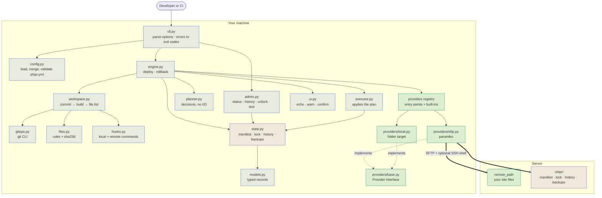

- **Plugins.** A new method (FTP, rsync, S3) is a separate package registered under the `shipr.providers` entry point. The core doesn't change.
- **Pure planner.** `planner.py` never touches disk or network, so its decision table is unit-tested directly.
- **One error type.** Every expected failure is a `ShiprError` from `errors.py` that carries its own exit code.

## Deploy at a glance

The six stages of `shipr deploy`. Each one has a detailed diagram below.

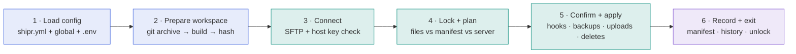

## Stage 1: Load and validate the configuration

Code: `cli.py · Ctx.env → config.load → Config.env`

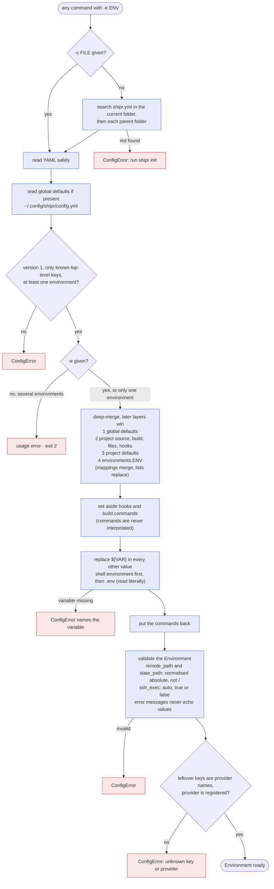

- **Why commands stay literal.** An expanded secret would be printed when the command runs and stored in deploy history. Commands read `$VAR` from their environment instead.
- **Where the provider block comes from.** Any extra key that matches the provider name (e.g. `sftp:`) becomes `env.provider_settings`. The provider validates it with its own model.

## Stage 2: Prepare the workspace

Code: `workspace.prepare · resolve_target · gitops.export · hooks.run_local · files.collect`

All of this runs on your machine, in a temporary folder, before anything connects to the server. The temp folder is deleted when the deploy ends, whatever the outcome.

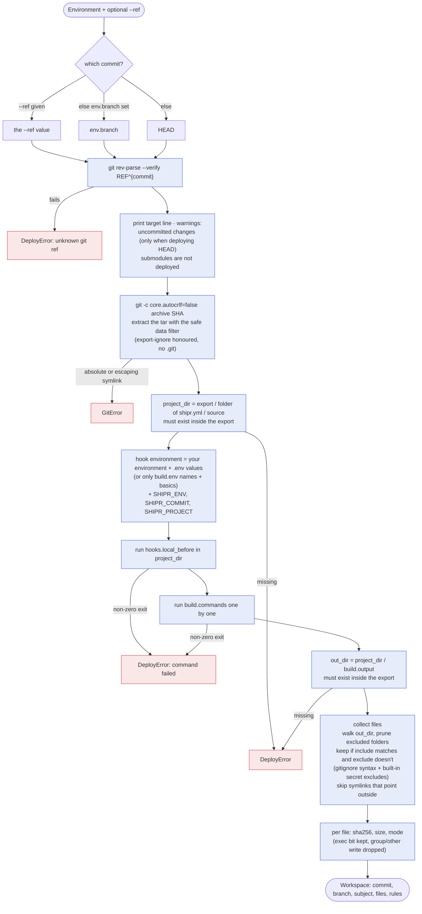

- **Why git archive.** It deploys exactly what was committed. Line-ending conversion is turned off, so Windows and Linux upload identical bytes, and a killed deploy leaves nothing behind in your repo.
- **Built-in excludes.** `.git/ .shipr/ .env .env.* *.pem *.key id_rsa* id_ed25519* shipr.yml node_modules/ *.log` and shipr's own temp names.
- **Dry run still builds.** `local_before` and the build run in a dry run too, because the plan needs the real build output.

## Stage 3: Connect to the server

Code: `engine.open_provider · SFTPProvider.connect / _connect_once / _retry`

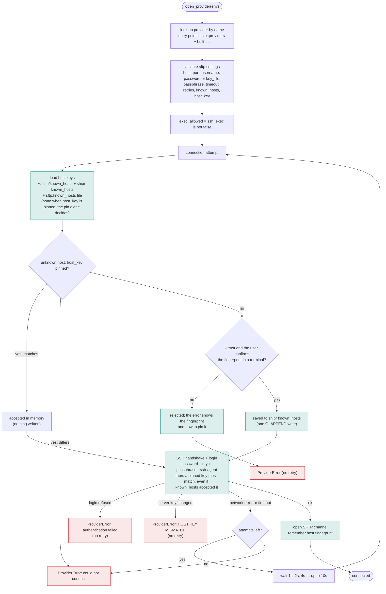

### Every SFTP operation after connecting

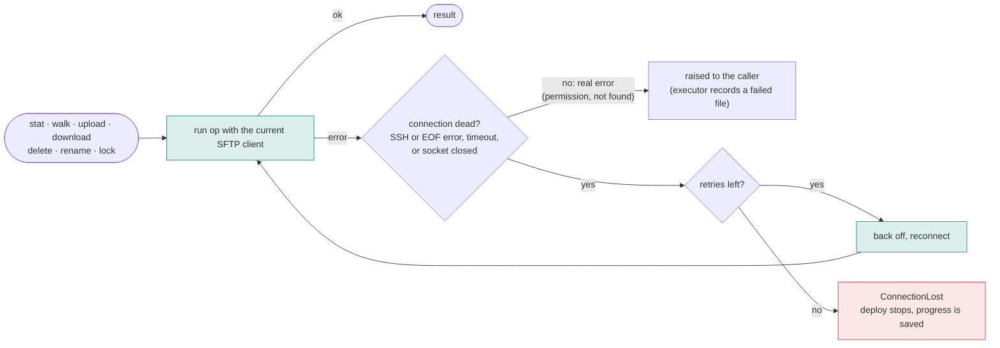

- **Fresh client per attempt.** Each operation receives the live SFTP client as an argument, so a retry can never reuse a handle to a closed connection.

## Stage 4: Lock and plan

Code: `engine.Deployment.run · _load_and_plan · state.RemoteState`

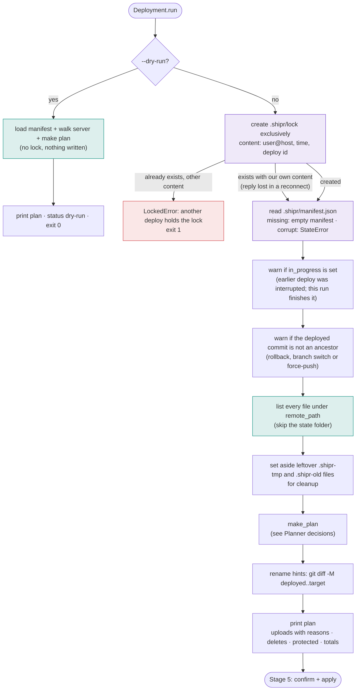

## Planner decisions

Code: `planner.make_plan · check_rel · stat_matches`

For every file, the planner compares three views: **L**, the file you are deploying (sha256 and size); **M**, its manifest entry from the last deploy (sha256, plus the size and modified time the server reported); and **R**, what the server lists right now.

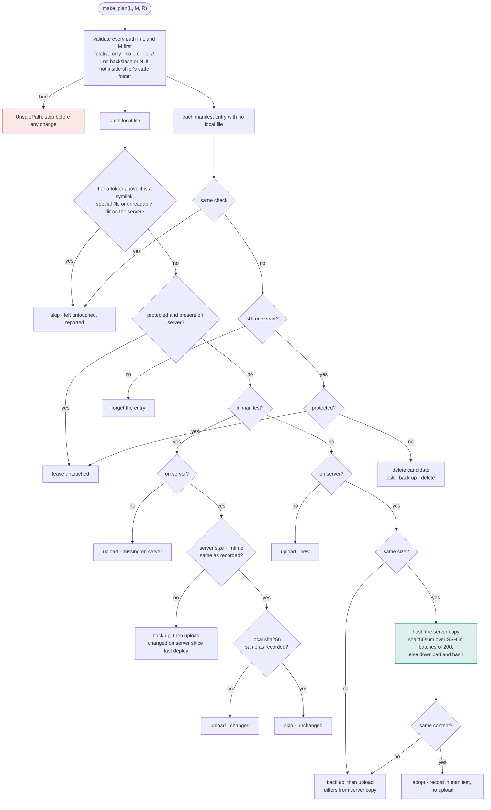

- **Server symlinks.** A file at or under a server symlink, special file or unreadable directory
  is never uploaded, deleted or forgotten, so shipr can't write through it into another folder.
  Providers re-check every directory with `lstat` right before each change, which catches a
  symlink that appears after planning. That file then fails and the deploy ends `partial`.
- **Leftovers.** Temp and parked files from an interrupted upload of a managed file are taken out
  of R. A park is removed after the run only if it matches the deployed version or a backup.
  Otherwise the deploy stops before any change. Look-alikes of other files are ordinary server
  files.
- **Files shipr never deployed.** A file that is on the server but in neither L nor M (user uploads, logs, server-only config) is never planned, so it can't be overwritten or deleted.
- **Why size + mtime for the server.** Reading them costs one directory listing per folder; hashing would mean downloading every file. The limit: an edit that keeps both the size and the old mtime goes unnoticed.

## Stage 5: Confirm and apply

Code: `Deployment._confirm · _apply · executor.PlanExecutor · hooks.run_remote_phase`

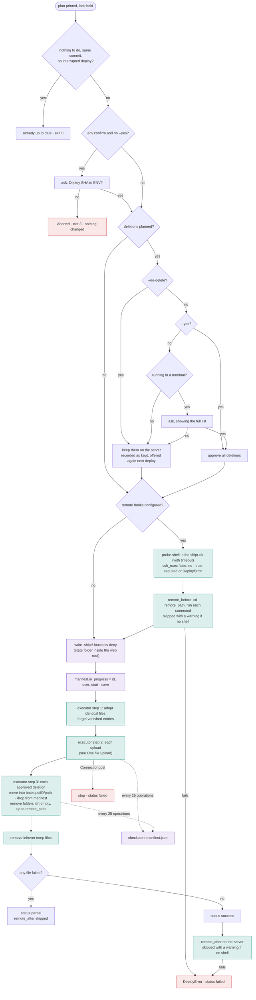

- **Per-file failures.** Permission denied or a full disk on one file is recorded under `failed` and the deploy carries on. Only a lost connection stops it.
- **"Delete" is a move.** Deleted files are moved into `.shipr/backups/<deploy-id>/`, so every deletion can be undone by hand.

## One file upload

Code: `PlanExecutor._upload · Provider.copy · SFTPProvider.upload / _replace`

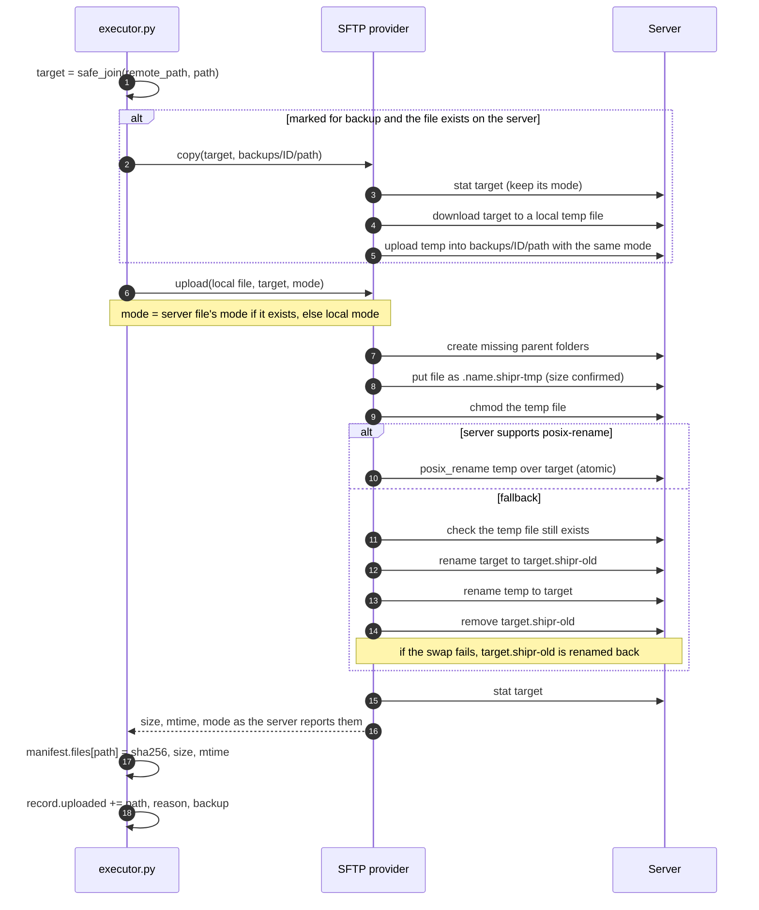

- **Why the temp name.** Visitors never see a half-written file: the real name only ever points to a complete file.
- **Why record the server's stat.** Next deploy, a different size or mtime on the server means someone edited the file after shipr did, so it gets backed up first.

## Stage 6: Record, unlock and exit

Code: `Deployment._apply finally · _save · run finally · engine.deploy · cli.ShiprGroup`

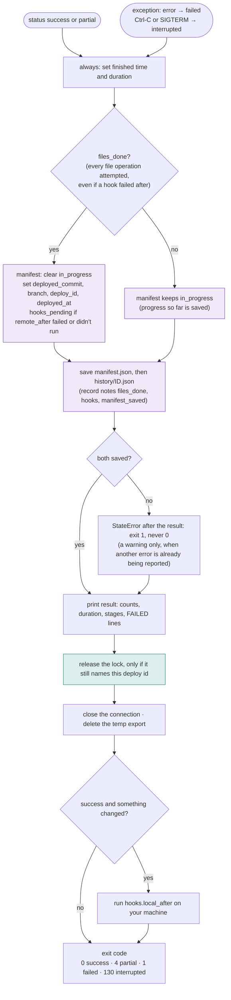

## Lock and recovery

Code: `state.acquire_lock / release_lock · manifest.in_progress · cli SIGTERM handler`

How a deploy moves through the lock and the `in_progress` marker, and how an interrupted run is finished.

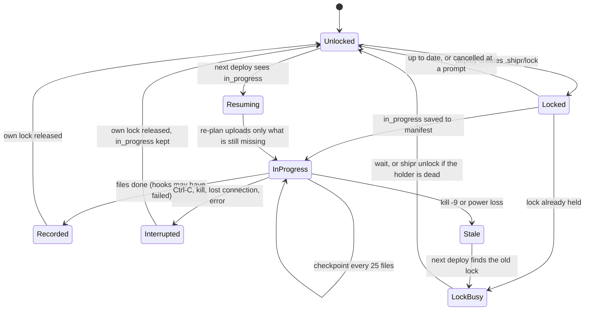

- **SIGTERM is Ctrl-C.** The CLI turns `kill` into the same interrupt as Ctrl-C, so progress is saved and the lock released.
- **Resuming needs no special code.** The next run compares contents again. Anything already uploaded is skipped or adopted, and the rest is uploaded.

## Rollback

Code: `engine.rollback · rollback_target`

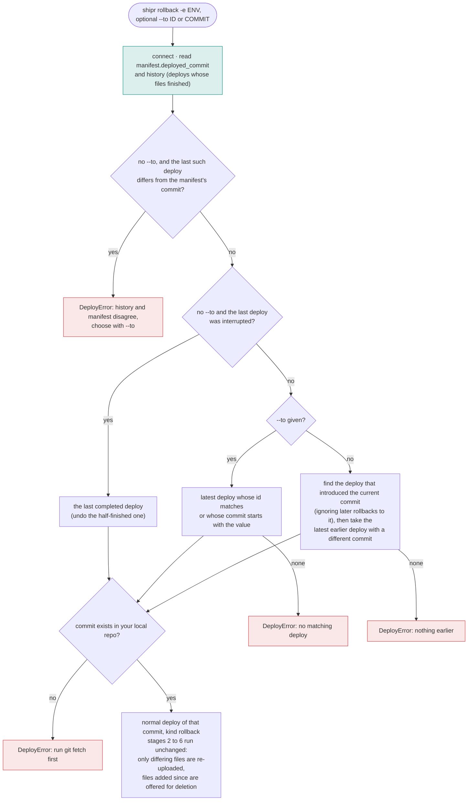

- **Repeated rollbacks.** History A → B → C, then rollback to B. Rolling back again goes to A, not back to C.

## Other commands

Code: `admin.status · admin.history · admin.unlock · admin.check_connection · cli init / validate`

```mermaid
flowchart TB
  subgraph S1["shipr status"]
    direction LR
    s1["connect"] --> s2["read manifest and lock"] --> s3["list remote_path"] --> s4["drift: tracked files missing,<br/>or size/mtime changed"] --> s5["compare env branch head<br/>with the deployed commit"]
  end
  subgraph S2["shipr history"]
    direction LR
    h1["connect"] --> h2["read history/*.json oldest first<br/>(unreadable records skipped)"] --> h3["list the last N,<br/>or --show ID as JSON"]
  end
  subgraph S3["shipr unlock"]
    direction LR
    u1["confirm, or -y"] --> u2["connect"] --> u3["read and delete .shipr/lock"]
  end
  subgraph S4["shipr test"]
    direction LR
    t1["connect, --trust allowed"] --> t2["host key fingerprint,<br/>login folder"] --> t3["create and delete a probe file<br/>in the state folder"] --> t4["count files in remote_path"] --> t5["shell probe"] --> t6["note if records sit in the web root"]
  end
  subgraph S5["shipr init and validate (no connection)"]
    direction LR
    i1["init: look at package.json or composer.json"] --> i2["write commented shipr.yml"]
    v1["validate: Config.env for every environment"] --> v2["print provider and remote_path, or the error"]
  end
```

## What shipr keeps on the server

Code: `state.RemoteState · models.Manifest · models.DeployRecord`

Everything lives under `state_path`, by default beside `remote_path`: `<parent of remote_path>/.shipr/<name of remote_path>`, so `/var/www/html` → `/var/www/.shipr/html`. That is outside the site only when `remote_path` is the web root. If the default has no `manifest.json` but `<remote_path>/.shipr/manifest.json` exists (shipr 0.1's default), the old location is used and a warning explains how to move it. If both exist, shipr stops and asks. Because it is on the server, every teammate and every CI run sees the same state. `manifest.json` also records the `project` and `remote_path` it belongs to. A deploy, `status` or `rollback` whose `remote_path` doesn't match refuses to use it.

```text
.shipr/
├── manifest.json        # files: sha256, size, mtime · deployed_commit · in_progress · hooks_pending · project, remote_path
├── lock                 # present while a deploy runs: user@host, time, deploy id
├── .htaccess            # deny web access, Apache only (only when inside the web root)
├── history/
│   └── 20261119T103205123Z-3f2a9c1.json   # one record per deploy: who, when, commit, every file, status
└── backups/
    └── 20261119T103205123Z-3f2a9c1/       # server copies saved before overwrite or delete, same paths
```

## Errors and exit codes

Code: `errors.py · cli.ShiprGroup.invoke`

| Code | When | Raised by |
|---|---|---|
| 0 | Success, already up to date, or a dry run | — |
| 1 | Config, git, connection, lock, state or command failure | `ConfigError`, `GitError`, `ProviderError`, `LockedError`, `StateError`, `DeployError`, `UnsafePath` |
| 2 | Wrong command-line usage, e.g. several environments and no `-e` | click |
| 3 | You answered no at a confirmation | `Aborted` |
| 4 | Partial deploy: some files failed. Deploy again to retry them. | record status `partial` |
| 130 | Ctrl-C or SIGTERM. Progress was saved. | `KeyboardInterrupt` |
